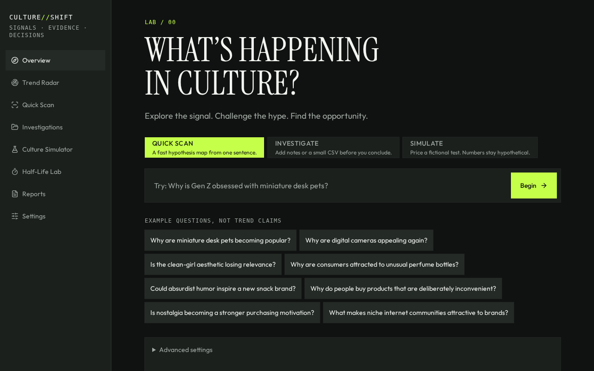
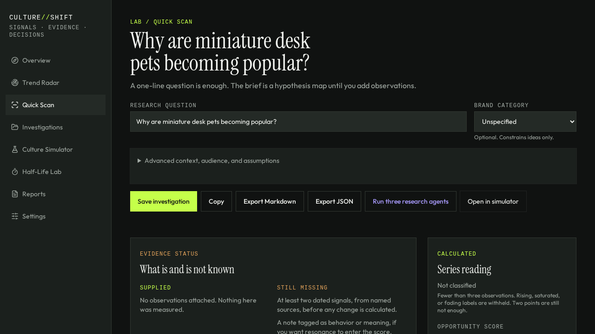
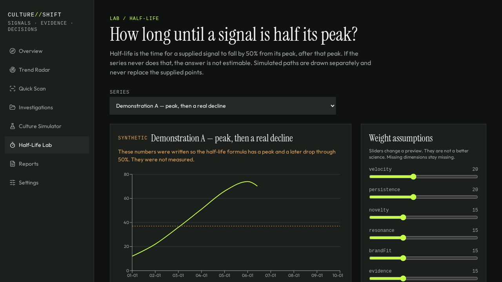
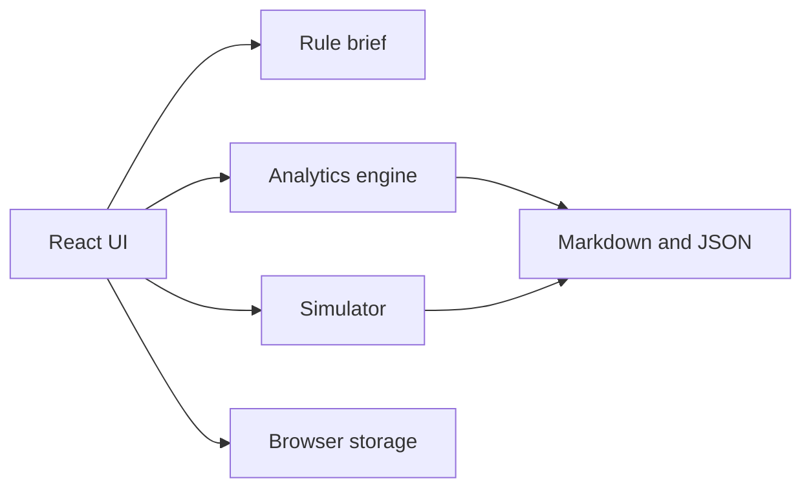

# CULTURE//SHIFT

Cultural signals. Evidence. Decisions.

An open-source cultural intelligence lab for Gen Z trend questions, marketing strategy, and business experimentation. It is built to be useful from a single sentence, and to stay honest when the evidence is thin.

This repository is a local-first web app. It is not a production forecasting system.

## Overview

Ask one question. The lab returns a structured brief: what the phrase refers to, why it might resonate, who might care, rival explanations, a brand hypothesis, a risk, and one cheap test.

Small amounts of data limit the strength of the conclusion. They do not block the brief. Missing numbers stay missing. The app will not invent search volume, engagement, dates, or a half-life.

## Features

These work in the app:

- Overview with Quick Scan, Investigate, and Simulate, plus example questions.
- Quick Scan hypothesis brief from the wording, with every line tagged as context, hypothesis, supplied, or missing.
- Trend Radar of eight labelled research cases. Not a live ranking.
- Observation entry and small CSV import. Blank signals are not stored as zero.
- Deterministic velocity, persistence, evidence coverage, lifecycle, and half-life.
- Opportunity score that renormalizes over measurable dimensions and refuses to score when fewer than two exist.
- Culture Simulator with pessimistic, baseline, and optimistic scenarios. Financial outputs come from formulas.
- Culture Half-Life Lab, including labelled synthetic series so the formula can be inspected.
- Investigations saved in the browser: rename, reopen, compare, delete.
- Markdown and JSON export.
- Settings for weights, an optional model key, the CSV template, and a clear-data action.

## Screenshots

Taken from the running app.







## Architecture



- The interface is one TanStack Start app. There is no separate API service.
- The brief, the score, the half-life, and the simulator are pure functions.
- Investigations live in `localStorage` on the device. There are no accounts.
- The interface does not call a language model.

See [docs/architecture.md](docs/architecture.md) and [docs/methodology.md](docs/methodology.md).

## Technology stack

- React 19, TanStack Start / Router, TypeScript
- Tailwind CSS 4
- Zustand for local persistence
- Node's test runner for the formula tests

Versions are pinned in `package.json` and `package-lock.json`.

## Getting started

Windows, macOS, or Linux:

1. Install Node.js 22.
2. Clone the repository and open a terminal in the project folder.
3. `npm install`
4. `npm run dev`
5. Open the local address the dev script prints.

No API key is required. Do not commit secrets. See `.env.example`.

`npm run test:lab` runs the formula tests. `npm run typecheck` checks TypeScript. `npm run build` produces the production bundle.

## Usage

**Quick Scan.** Type a question, or pick an example. You get a brief immediately. Save it if you want it on the shelf.

**Investigate.** Same brief, with the observation panel open. Add dates, optional signals, notes, and a kind (`attention`, `behavior`, or `meaning`). Import a CSV if you have one.

**Trend Radar.** Browse the shelf. Filters cover category, lifecycle, evidence, and a brand angle. Lifecycle is “Not classified” until a saved series has enough dates.

**Culture Simulator.** Set price, cost, budget, assumed reach, and assumed conversion. Compare three scenarios. Attach the scenario to an investigation if you want it in the export.

**Half-Life Lab.** Load one of your series, or a synthetic demonstration. The demonstration is not a measurement.

**Reports.** Export the selected investigation. The file is stamped with the time of export.

## Methodology

Detail is in [docs/methodology.md](docs/methodology.md). Short version:

- Velocity needs two dates. One observation is descriptive only.
- Persistence needs three points and a positive peak.
- Half-life is the time from the peak until the signal reaches 50% of that peak. Otherwise it is not estimable.
- Novelty and brand fit enter the score only as assumptions you turn on.
- Resonance uses notes you tag as behavior or meaning. Attention counts do not substitute.
- Evidence quality is a coverage index. Zero observations score 0 by an explicit rule.
- The opportunity score drops any dimension it cannot measure, renormalizes the remaining design weights, and stays unscored if fewer than two dimensions remain. It is not a probability of commercial success.

## Interpretation

The lab does not call a model unless you save your own key under Settings. That key stays in this browser. It is sent only when you click **Ask your model**, and it is never written into an export or into git. The local brief still works with no key. The simulator never takes numbers from model prose.

## Data sources

- Eight sample cases in `src/lib/culture/sample.ts`. Prompts, not measurements.
- Three synthetic series, opt-in, labelled, for the half-life formula.
- Rows you type or import. Provenance is `user`, `csv-import`, or `synthetic-demonstration`.
- No live social or search connector is implemented.

## Testing

```bash
npm run test:lab
```

Those tests cover single observations, missing values, duplicates, half-life, score renormalization, simulator arithmetic, and the refusal to invent a history for an unknown question. Latest local run: 22 passed, 0 failed.

## Limitations

- A brief without observations is a hypothesis map.
- Keyword frames are not evidence that a trend exists.
- Sparse series cannot support growth, persistence, or half-life. The UI says so.
- Simulator units are `reach × conversion × scenario factor`. That is an assumption stack.
- Scenario factors (0.5, 1, 1.6) are illustrative.
- There is no forecast, and no claim of commercial accuracy.
- Browser storage does not sync across devices.

## Roadmap

Implemented: the list under Features.

Not built, and not pretended: live TikTok, Instagram, Reddit, or search monitoring; accounts; a shared database; a trained opportunity model; automatic scraping. A model is used only if you add your own key.

## Contributing

Open a change against the formula tests first if you touch scoring or the simulator. Do not add a metric that fills missing values with zero unless the rule is explicit and tested. Do not commit secrets, private datasets, or local database files.

## License

MIT. See [LICENSE](LICENSE).
