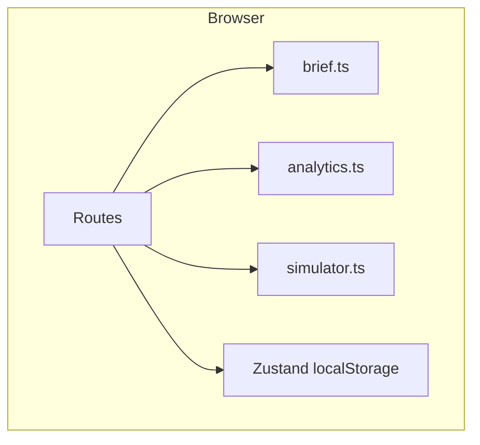

# Architecture

CULTURE//SHIFT is one web app. The original brief allowed a Next.js frontend plus FastAPI. This environment ships TanStack Start, so the analytical engine lives in TypeScript modules instead of a second process. The formulas are the same idea: pure, testable, and separate from the model.

| Module | Responsibility |
| --- | --- |
| `src/lib/culture/brief.ts` | Keyword frames and the hypothesis brief. No metrics. |
| `src/lib/culture/analytics.ts` | Series prep, velocity, persistence, half-life, score. |
| `src/lib/culture/simulator.ts` | Hypothetical P&L. |
| `src/lib/culture/fallback-agents.ts` | Unused by the screen. Covered by a unit test only. |
| `src/lib/culture/report.ts` | Markdown and JSON. |
| `src/lib/culture/store.ts` | Investigations and weights on the device. |
| `src/components/` | Interface. No scoring logic that the modules do not own. |

Routes: Overview, Trend Radar, Quick Scan, Investigations, Culture Simulator, Half-Life Lab, Reports, Settings.

Nothing in an investigation record stores an API key.
